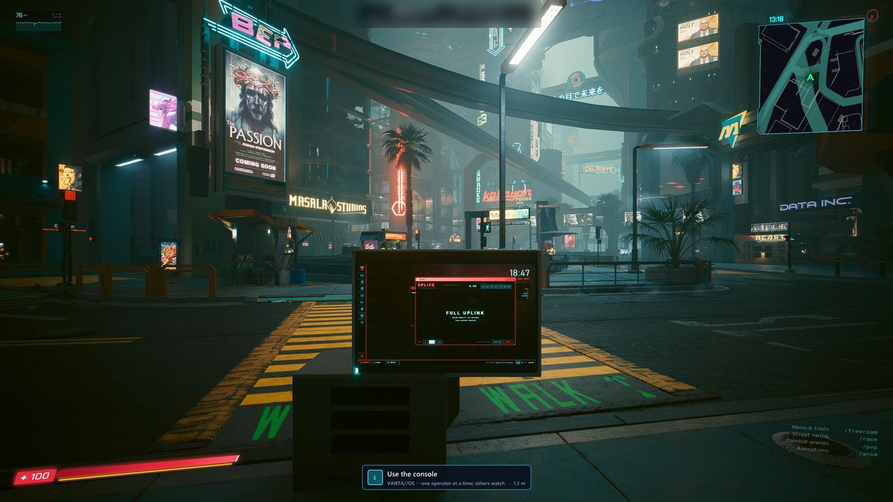
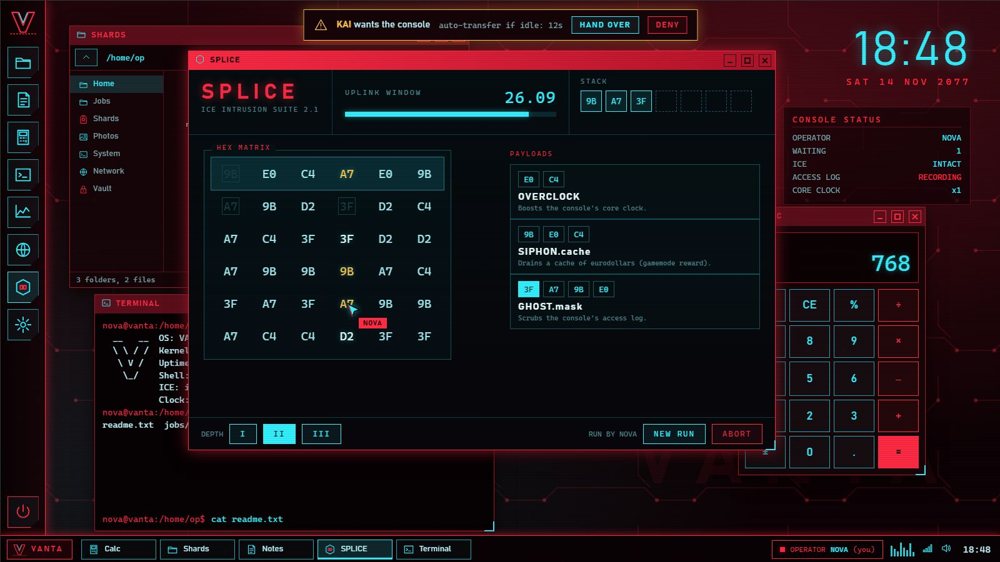

# open77_vantaos

VANTA//OS, for [Open77](https://open2077.net) servers, is a whole desktop running on a console in the world, the same for every player standing near it. It shows what a WebUI page on a world screen can do: the page becomes the material of the console's panel (`Open77.screens`), one player operates it with the mouse and keyboard, and everyone else nearby watches the windows, the apps and the pointer move live.



- **Docs:** [World screens](https://open2077.net/docs/world-screens)
- **Starts:** with `ensure open77_vantaos` (it declares `auto_start false`)
- **Needs:** `open77_worldui` (the "Use the console" prompt), a client with `Open77.screens` (237+), game build 2.5
- **Runs on:** server and client

## Install

```sh
git clone https://github.com/Open2077/open77_vantaos.git resources/open77_vantaos
```

The directory must stay named `open77_vantaos`. `open77_worldui` ships with every Open77 server
package; load both in `server.jsonc`:

```jsonc
"resources": { "load": [ /* ... */ "open77_worldui", "open77_vantaos" ] }
```

Then `refresh` in the server console. The commands below need the ACL entries
`command.vos_place`, `command.vos_remove`, `command.vos_reset`, `command.vos_dump` and
`command.vos_demo` (or `command.*`) for the players who use them in game.

## Try it

1. `ensure open77_vantaos` in the server console.
2. Place a console: in game `/vos_place [id]` (ACL `command.vos_place`) puts one 2.6 m in front of you, facing you. From the server console, use `vos_place <playerId> [id]` or `vos_place <x> <y> <z> <yaw> [id]`. Placed consoles are saved and come back after a restart. Fixed consoles can also be listed in `shared/config.lua` (`stations`).
3. Walk up and press **E** on the prompt (or **J**, or type `/vos`). The camera frames the panel and your mouse drives the page. **Escape** gives the console back.
4. Another player nearby presses **E** to ask for the console. The operator sees **HAND OVER / DENY** on the screen. If the operator stops touching the console for 15 s, it passes to the oldest request on its own.
5. `vos_demo [id]` (ACL) lets a scripted operator, `GHOST//DEMO`, drive the console: it types a note, drags a window and solves a SPLICE run. This is the quickest way to see the sync from a viewer's place with a single client. Pressing E takes over at once.

Other commands (ACL): `vos_remove [id]`, `vos_reset [id]` (fresh desktop), `vos_dump` (one line per console: operator, viewers, windows, document size).

## What is on it

| App | What is shared |
|---|---|
| Window manager | open, close, minimise, maximise, drag, resize, focus and stacking order, taskbar, start menu |
| Shards (files) | the folder, the selection, the scroll. `/vault` stays locked until SPLICE uploads ROOT//KEY |
| Notes | the text as it is typed, and the scroll |
| Calc | the display and every key press (the key flashes for viewers) |
| Terminal | the history, the line being typed, the folder (`help`, `ls`, `cd`, `cat`, `open <app>`, `neofetch`...) |
| Sysmon | gauges and processes computed from the server clock (identical without traffic), killed processes, the selection |
| Glint (browser) | tabs, history, back and forward, the address being typed, reloads, the scroll of `vanta://` pages |
| Display | the wallpaper and accent colour |
| SPLICE | the whole run, authoritative on the server |

The browser has a `vanta://` intranet that the page draws itself: a portal, a news feed, a live market and a directory. Everything in it is synced, scroll included. It can also open an outside `https://` site in a frame. Each player's browser loads that site itself, and only the address and history are shared. Before framing a site, the page asks the host's frame probe (`/op77/web/frame`, the television's), so a site that refuses to be framed (`X-Frame-Options` or `frame-ancestors`, which Google and most big sites send) gets a clear card instead of a blank frame. A shell around another site opens that site instead. Popups and advertising follow the host's existing rules. This is why the page is created with `policy = "media"`, the policy that may frame `https:` sites and ask the probe. With a client that supports `frameAnySite` (permission `webui.frame_any`, declared here), the host drops `X-Frame-Options` and `frame-ancestors` for Glint's frames, so google.com, youtube.com, github.com, reddit.com and similar sites load instead of showing the card. Sites that hide themselves in script when framed, or that need first-party cookies, can still fail. The frame is sandboxed without top navigation.



## SPLICE

SPLICE is an intrusion app built on a mechanic players know: a matrix of hex pairs. You pick along the lit row, then along the column of that cell, then a row again. Each pick goes onto a short stack, and a payload uploads when its sequence appears, in order, in the stack. The uplink timer starts with the first pick. Three depths (`I`, `II` and `III`) set the grid size, the stack length and the time. Cells that would advance a payload are hinted in amber.

The rules run only on the server (`server/splice.lua`). A page sends only "pick cell N", and the server checks the line, the cell and the clock. Every puzzle is generated as slices of one legal walk, so it can always be fully solved; the tests check this with an exhaustive solver.

**Hook for gamemodes:** when a run ends, the server publishes

```lua
AddEventHandler("open77_vantaos:spliceResult", function(result)
    -- result = { station, player, name, outcome = "won"|"partial"|"lost", success,
    --            uploaded = { "rootkey", ... }, failed = { ... }, reason, level }
    -- player is -1 for the scripted demo: ignore it.
end)
```

The built-in payloads change the console: `rootkey` opens `/vault`, `ghost` scrubs the access log and `overclock` doubles the core clock. `siphon` is a pure gamemode reward. Payloads and depths are listed in `shared/config.lua`.

Server exports: `place(def)`, `remove(id)`, `list()`, `release(id)` and `startSplice(id, level)`.

## How the sync works

- **Authority.** The server holds one document per console. The operator's page turns an action into small ops with `web/core.js` (`["s", path, value]` set, `["d", path]` delete, `["p", path, value, cap]` push) and applies them at once. The server checks them (`server/doc.lua`: allowed roots `wm`/`app` only, key shapes, sizes) and relays them. A batch that breaks a rule is refused whole, and the sender gets the server's copy back. `sys` (power, rewards) and `hack` (SPLICE) are written by the server only.
- **Control.** A server-side lock: one operator, a queue of requests, hand-over (the operator accepts, or is idle for 15 s), release on Escape, distance (6 m), disconnect, or 3 minutes idle with nobody waiting. A page that still sends after losing control is resynced.
- **Rates.** The operator's page sends at most one batch per 66 ms. Each batch holds the coalesced ops (a drag sends one geometry per batch) plus pointer samples taken at 30 Hz, only when the pointer moved. That is ~15 events a second, a fraction of the platform's 192/s budget. The server relays each batch to the console's viewers only, so the cost is O(viewers of that console). Viewers replay the pointer 110 ms late with interpolation, and windows glide between updates.
- **Streaming.** Every second, `Open77.players.nearby` per console subscribes players within 28 m (dropped beyond 34 m). A new viewer gets the whole document as a snapshot, split into chunks under the 16 KiB event-string bound and capped at ~30 KB. Clocks shown on the screen (boot sequence, SPLICE timer, sysmon, market) derive from the server clock carried in every message, so late joiners see the same moment.
- **Persistence.** Each console's document is saved in the resource kvp every 5 s when it changed, so a console keeps its desktop across `ensure` and restarts.

## Tests

```bash
node --test tests/core.test.mjs          # reducers, sync contract, cursor, JS twin vs Lua
python tests/run_lua_tests.py            # Lua 5.4 (pip install lupa): ops, SPLICE, server simulation
```

`run_lua_tests.py` runs the real `server/main.lua` against stubbed Open77 APIs. It covers streaming, the lock, requests and idle take-over, relaying, refusals and resyncs, SPLICE with its hook and timeout, the demo, persistence, and the snapshot size. It also replays the node test's ops through the Lua document to show both sides end up with the same document.

`tests/preview.html` runs the OS in a desktop browser with a mock server and two players side by side. Serve the repository folder (`python -m http.server` from it) and open `/tests/preview.html`; `?scene=desktop|web|splice|splice-end` plays a scripted scene. Nothing under `tests/` or `docs/` is shipped to players.

## Limits

- Outside sites in Glint: only the address, history and reloads are shared. Clicks and scrolling inside a cross-origin frame stay on the operator's screen, because the page cannot see into the frame. While the operator's pointer is inside one, viewers see the shared pointer parked and dimmed at its edge.
- The screen is the game's 16:9 TV panel raised on an office desk (`model`, `raise` and `decor` in the config). Another mesh with a screen material works too.
- A SPLICE run in progress does not survive a resource restart; the console comes back idle.

## License

[MIT](LICENSE). The console is built from the game's own props at run time; this repository ships
none of the game's files. Sites opened in Glint belong to their owners.
